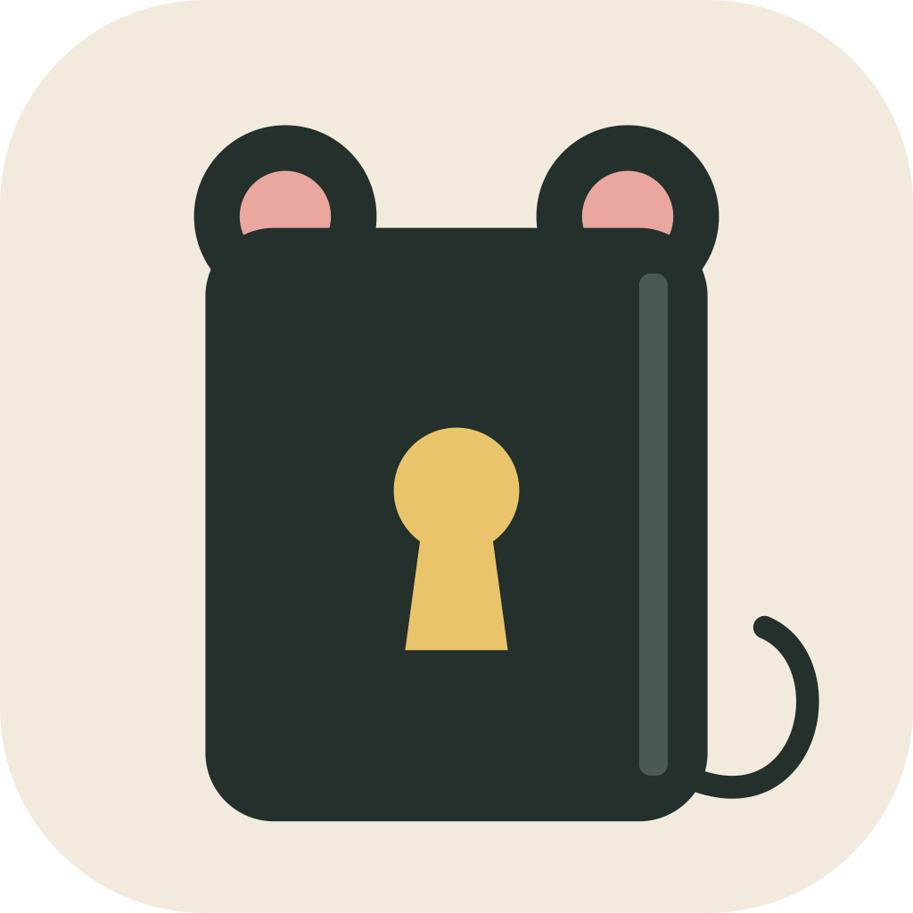

<div align="center">



# Rat Journal

A private, encrypted, offline desktop journal.

</div>

> [!NOTE]
> **This is a personal project.** I built Rat Journal for my own use and published the source so it can be read and audited. It is not a product: there is no support, no roadmap, no promise of updates or backward compatibility, and no code signing. Issues and pull requests may go unanswered. If you want to use it anyway, you are welcome to under the MIT license — but you do so at your own risk, and you should keep your own backups.

## What it is

Rat Journal keeps your journal in a single encrypted file on your own computer. It never connects to the internet: no accounts, no sync service, no telemetry, no update checks, and no links to outside websites. The only thing that opens a browser is a link you put in one of your own entries.

## Security

- **Encryption at rest**: every entry title, body, tag, image, and attachment is encrypted with AES-256-GCM under a random 256-bit master key. A copy of the journal file shows only ciphertext.
- **Password**: the key that unlocks the master key is derived from your password with Argon2id (256 MiB, 4 passes, under a second) each time you unlock. It is never written to disk; the journal stores only a random salt and the Argon2 settings.
- **Key files (optional)**: a key file holds 32 random bytes. Its slot locks the master key with AES-256 under an HKDF-SHA256 key derived from the file, and stores no public key.
- **Quantum-resistant**: everything that protects a journal at rest is symmetric or a hash (AES-256, Argon2id, HKDF/HMAC-SHA256), so a future quantum computer gains only a modest speed-up. A password is still only as strong as you make it.
- **Older journals upgrade themselves**: a journal written in an older key format is moved to the current one on its next unlock, and its master key is replaced. Delete backups made before that upgrade; they still use the old key.
- **Dead man's switch (optional)**: a journal or the vault can be set to erase itself permanently if it isn't unlocked within a number of days. It acts only when Rat Journal runs, and can't reach copies elsewhere (cloud version history, trash).
- **Panic password (optional)**: typing it at the unlock screen erases the journal (and optionally the vault) and opens a decoy journal instead.
- **Clock-change detection**: each journal and vault remembers the latest time it was open, sealed with its key, and warns after unlocking if the computer's clock has been set earlier.
- **No network access**: a strict content security policy and WebView-level blocking keep the app offline.

What it does **not** protect against: someone using your computer while the journal is unlocked, or malware already running on it. Turn on auto-lock (Preferences → Security) and use full-disk encryption (BitLocker).

Full details: [SECURITY.md](SECURITY.md).

## Features

- Rich text editor with images and file attachments
- Several entries per day, tags, calendar and timeline views, search
- Multiple journals (personal, work, travel)
- An encrypted file vault: a folder (for example in Google Drive) of individually encrypted files with its own unlock, in-app preview for PDFs and images ([format](docs/VAULT_FORMAT.md))
- Password and/or key-file unlock, or a local-only journal that opens without a password on this device
- Automatic verified backups, with per-entry restore
- Import from Day One (JSON/TXT) and jrnl (JSON); export to JSON, Markdown, or PDF
- Themes (Light, Dark, Black, Violet), statistics, auto-lock for the journal and separately for the vault, lock when Windows locks

## Install (Windows)

Run `Rat Journal_<version>_x64-setup.exe` (or the `.msi`).

- The installer is not code-signed, so Windows SmartScreen warns you: choose **More info → Run anyway**.
- It installs for all users, so it asks for administrator permission.
- App settings live in `%APPDATA%\local.ratjournal.app`. New journals are created in `Documents\Rat Journal` unless you pick another folder.

## Install (Linux, Flatpak)

Download `Rat-Journal_x86_64.flatpak` from the release, then:

```bash
flatpak remote-add --user --if-not-exists flathub https://dl.flathub.org/repo/flathub.flatpakrepo
flatpak install --user Rat-Journal_x86_64.flatpak
flatpak run io.github.ratknight.RatJournal
```

The first install pulls the GNOME runtime from Flathub. The installed app has no network permission at all, so the kernel blocks every outbound connection from it.

To build the bundle yourself on Linux (needs `flatpak-builder`), or run the **Build Flatpak** workflow on GitHub:

```bash
flatpak-builder --user --install-deps-from=flathub --install --force-clean build-flatpak flatpak/io.github.ratknight.RatJournal.yml
```

## Building a new .exe

### One-time setup (Windows)

- Rust via [rustup](https://rustup.rs) (the toolchain version is pinned in `rust-toolchain.toml` and installs itself)
- Visual Studio 2022 Build Tools with the **Desktop development with C++** workload
- [Bun](https://bun.sh) 1.x
- Node.js LTS (only needed to run the tests)

### Build

```bash
git clone https://github.com/RatKnight/rat-journals.git
cd rat-journals
bun install
bun run tauri build
```

To build again later from an existing clone, pull the latest changes first:

```bash
git pull
bun install
bun run tauri build
```

The installers land in `target/release/bundle/nsis/` and `target/release/bundle/msi/`; the plain executable is `target/release/rat-journal.exe`.

### Tests

```bash
cargo test --workspace          # Rust
bun run test:run                # frontend (needs Node.js)
bun run test:e2e:local          # end-to-end, drives the built app (needs: cargo install tauri-driver)
```

## Keyboard shortcuts

| Action                     | Shortcut       |
| -------------------------- | -------------- |
| Previous day with an entry | `Ctrl+[`       |
| Next day with an entry     | `Ctrl+]`       |
| Go to Today                | `Ctrl+T`       |
| Go to Date                 | `Ctrl+G`       |
| Previous Month             | `Ctrl+Shift+[` |
| Next Month                 | `Ctrl+Shift+]` |
| Preferences                | `Ctrl+,`       |

Statistics, Import, and Export are in the ⋮ menu.

## Credits

Rat Journal is based on [Mini Diarium](https://github.com/fjrevoredo/mini-diarium) by Francisco J. Revoredo, used under the MIT license. Thank you for building it. Rat Journal adds its own security changes, the encrypted file vault, and a new name and logo; it is not affiliated with or endorsed by the original project, so please report problems with Rat Journal here rather than there.

## License

MIT. See [LICENSE](LICENSE). Provided as is, without warranty of any kind.
